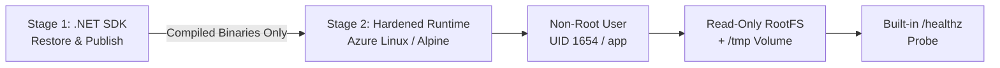

# .NET Hardened Containers

[](https://github.com/papilias/dotnet-hardened-containers/actions/workflows/hadolint.yml)

Production-hardened multi-stage **Dockerfile** patterns for **.NET 8 / .NET 10** microservices running on **Azure Linux 3.0** and **Alpine**, built for zero-root execution, minimal attack surface, and PCI/FIPS-compliant Kubernetes deployments.

## Hardening Architecture



## Base Image Comparison

| Pattern | Base Runtime Image | Shell Included | Non-Root Default | Primary Use Case |
| :--- | :--- | :---: | :---: | :--- |
| **`Dockerfile.azurelinux`** | `mcr.microsoft.com/dotnet/aspnet:10.0-azurelinux3.0` | Minimal (`tdnf` stripped) | Yes (`app`) | Enterprise & PCI/FIPS workloads on AKS |
| **`Dockerfile.alpine`** | `mcr.microsoft.com/dotnet/aspnet:10.0-alpine` | Minimal (`ash`) | Yes (`app`) | Ultra-compact internal microservices |

## Repository Structure

```text
.
├── docker/
│   ├── Dockerfile.azurelinux   # Hardened Azure Linux 3.0 multi-stage build
│   └── Dockerfile.alpine       # Hardened Alpine multi-stage build
├── kubernetes/
│   └── deployment-security.yaml # Pod SecurityContext (readOnlyRootFilesystem, drop ALL caps)
└── .github/
    └── workflows/
        └── hadolint.yml        # Automated Dockerfile linting via Hadolint
```

## Design Decisions
- **Multi-Stage Separation:** The .NET SDK, NuGet caches, and build tools remain strictly in the `build` stage and are never shipped to production, eliminating unnecessary compilers and package managers from the runtime container.
- **Non-Root & Read-Only Filesystem:** Containers run under the unprivileged `app` user (`UID 1654`) on port `8080` (avoiding privileged ports `<1024`), paired with Kubernetes `readOnlyRootFilesystem: true` and `capabilities.drop: ["ALL"]`.
- **FIPS & Compliance Alignment:** Using **Azure Linux 3.0** runtime images ensures native OpenSSL/SymCrypt integration when deployed onto FIPS-enabled AKS node pools.
